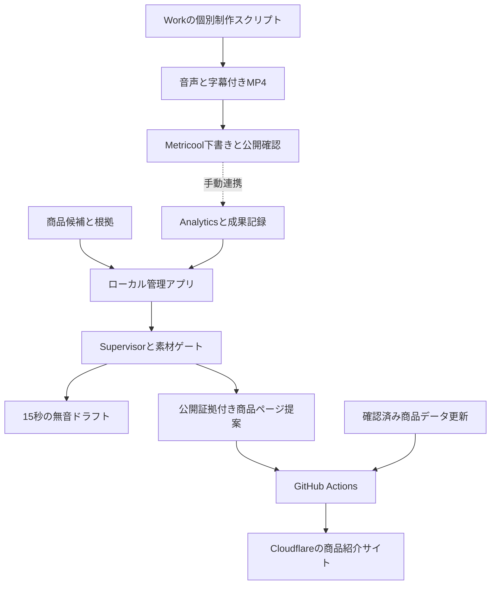

# Affiliate AutoPilot 技術引き継ぎ書

最終確認日：2026-10-16（JST）  
対象リポジトリ：[tamachano/affiliate-autopilot](https://github.com/tamachano/affiliate-autopilot)（private）  
調査基準コミット：`db30fc19ab3d59e77c675659208afc213821dc87`（main。本文保存前のコード）

## 0. 引き継ぎ時点の結論

**商品紹介サイトは8商品で公開・稼働を確認した。一方、商品調査→素材確認→完成動画→投稿→成果取得までの完全自動運転は完成していない。** GitHubのローカル管理アプリ、Cloudflareの商品サイト、Work内の個別動画制作、Metricoolの投稿機能は別の実行系である。

- v3「神アイテムTOP5」は45.4秒の音声・字幕付きMP4が存在する。Metricoolでは下書きで、`autoPublish:false`、YouTube設定は`private`。公開済み動画とは扱わない。
- A「デスク周りのストレスを解消する神アイテム4選」／B「勉強・作業がはかどる神文房具4選」は企画と音声付き模式図プレビューまで。商品写真・個別許諾・適格な成果リンクが未確定で、完成広告ではない。
- 今回の再検証：TypeScriptビルド成功、既存テスト4件中3件成功・1件失敗。本番静的4ファイルのバイト一致成功。隔離したローカルサーバーのhealth成功。
- 最優先の技術課題は、テストの固定商品数、Analytics指標の誤った名称対応、制作系統の統合と再現性、クリック・成果の計測である。
- 今回はコード修正・デプロイ・投稿・新しい広告動画制作を行っていない。テストが一時ディレクトリに生成する合成映像は検証用で、広告や公開物ではない。

### 状態の読み方

|表記|意味|
|---|---|
|実装済み|対象コード／成果物が存在する。実運用の検証範囲は別途記載|
|部分実装|処理の一部のみ存在し、接続・汎用化・最後の検証が不足|
|未実装|今回確認したソースに当該機能がない、または明示的に未実装|
|未確認|証拠が取得できず、成功・失敗を判断しない|

旧README・制作キットの「3商品のサイト」「5商品未掲載」「投稿接続未確認」は作成当時の記録である。現在の外部状態は本書の確認結果を優先する。過去の検証を削除して辻褄を合わせない。

## 1. 目的と現在の制作方針

初期目標はShorts経由でアフィリエイト成果を1件発生させること。高額報酬は必須でない。対象は年齢ではなく「勉強や仕事でデスクを使い、小さな不便を解消したい人」。A/Bのテーマ差を検証する。コード内の「学生向け」「3選」は旧方針であり、新方針への全体更新は未完了。

商品URL、レビュー用動画、公開許諾、アフィリエイト対象資格は別の証拠として管理する。競合素材を転載せず、編集構造を学んで独自素材で再構成する。現在の依頼は技術引き継ぎのみで、新しい動画やv4の制作・公開を開始しない。

## 2. システム全体構成



破線は自動接続が完成していない箇所。v3制作は管理アプリの15秒レンダラーから生成されたものではない。商品サイトへの直接更新経路もあり、キャンペーンの厳しいゲートがすべてのサイト変更に一律適用される構成ではない。

### 2.1 GitHubのディレクトリ

|パス|役割・正本|
|---|---|
|`data/products.json`|公開商品の唯一の正本。現在8件|
|`data/product-map.json`|制作側商品IDと既存サイト商品番号の対応|
|`data/campaigns/*.json`|制作依頼。1リクエスト＝1コミットが前提|
|`data/campaign-results/*.json`|Actionsによる実行結果の保存|
|`public/`|Cloudflareへ配置する静的公開物のみ|
|`public/products.js`|`scripts/build.cjs`の生成物。直接編集しない|
|`scripts/build.cjs`|商品データ・URL形式などの検証とビルド|
|`scripts/verify-live.cjs`|本番とローカルの4ファイルをバイト比較|
|`wrangler.jsonc`|既存Worker `jinsei-no-sitsu` の設定|
|`.github/workflows/deploy.yml`|商品サイトの公開・公開後検証|
|`.github/workflows/campaign.yml`|制作準備、テスト、実行結果保存、条件成立時のサイト公開|
|`autopilot/src/`|TypeScriptの管理アプリ・企画・Supervisor・分析・キャンペーン|
|`autopilot/public/`|管理UI。ルートの`public/`とは別物|
|`autopilot/data/products.seed.json`|制作候補データ。公開商品一覧とは別|
|`autopilot/data/creative-research.json`|旧競合調査データ。現在のローカル調査一式とは別|
|`autopilot/scripts/`|リンク生成・写真プレビューなど|
|`autopilot/tests/campaign.test.mjs`|4件の統合テスト|
|`pod/`、`.github/workflows/pod-*.yml`|同居するSUZURI商品の別系統運用|

実行時の`autopilot/db/affiliate-autopilot.sqlite`、`output/`、`dist/`、`.env`、`node_modules/`はGit管理外。**GitHubをcloneするだけでは、過去の実験DBやOAuth接続は復元されない。**

### 2.2 GitHubに入っていない制作・調査ワークスペース

以下は今回のWorkの相対パス。新Workで同じ絶対パスが存在するとは限らない。

|パス|内容|
|---|---|
|`production/setup-runtime.py`、`get-assets.py`|CPU音声環境準備、DRESS公式配布素材の取得|
|`production/v3-audio.py`、`v3-render.py`、`v3-package.py`|v3の音声・映像・構成書生成|
|`production/assets/`、`selected-images.json`|許諾対象の元写真と選択ファイル対応|
|`production/runtime/`|VOICEVOXモデル・辞書・ONNX Runtime・フォント・Pythonパッケージ|
|`production/v3/deliverables/`|完成MP4・台本・32カット表・字幕・QAなど|
|`prepublish/site/`|サイト更新用作業コピー。GitHub側が現在の正本|
|`prepublish/`|公開前確認・サイト導線・音声QAの過去記録|
|`research/deliverables/`|A〜D調査、`research-data.json`、v3測定|
|`reshare/E-競合映像の視聴可否検証.md`|後から更新されたE資料のローカルコピー|
|`desk-study-research/deliverables/`|A/B商品調査、絵コンテ、素材台帳、各41秒の計画|
|`desk-study-research/make_previews.py`、`video-previews/`|A/B音声付き模式図プレビューとQA|

作業パスを公開サイトの`public/`へコピーしない。元写真・モデル・認証情報・非公開の競合画面録画を静的公開物へ含めない。

### 2.3 使用技術

|系統|実装・依存|
|---|---|
|管理アプリ|TypeScript、Node.js組み込みHTTP、`node:sqlite`、素のHTML/CSS/JavaScript。React/Next.jsではない|
|Node環境|`engines: >=22.5`、ActionsはNode 22。今回ローカル実測Node 24.19.0／npm 11.9.0。依存はTypeScriptと`@types/node`|
|商品サイト|静的HTML/JS、Cloudflare Workers Static Assets、Wrangler 4。`compatibility_date: 2026-10-06`|
|動画制作|Python 3.12.14、Pillow 12.3.0、NumPy 2.3.5、FFmpeg 6.1.1、H.264/AAC|
|音声|VOICEVOX Core 0.17.0、VVM 0.16.4、VOICEVOX ONNX Runtime 1.23.2、OpenJTalk辞書1.11、CPU|
|文字|Noto Sans JP／OFL、fonttools 4.60.1。商用利用条件・クレジットを記録|
|投稿|接続済みMetricoolのYouTube投稿機能。本体の独自アップロードAPIとは別|
|分析|Google YouTube Data API／YouTube Analytics APIの読取コード、手入力スナップショット、vidIQ外部分析|
|任意のAIレビュー|OpenAI Responses API。キーなしではローカルルール。API利用は別料金|

## 3. 実装・稼働状況

|機能|状態|実際に確認した範囲と限界|
|---|---|---|
|商品候補選定・スコア|実装済み|seedデータをルールで抽出・採点。ライブEC検索・市場評価ではない|
|1商品／3商品の企画|実装済み|台本・絵コンテ・実験ID・素材マニフェスト生成。4／5商品は本体未対応|
|Supervisor／Humanizer|実装済み|最大3回、変更履歴保存、ローカルレビュー。GOは売上予測の検証結果ではない|
|外部モデルレビュー|部分実装|Responses APIコードあり。今回有料モデルの実行・認証は確認していない|
|素材ゲート|実装済み|ID、実ファイル、HTTPS証拠、厳密なboolean、media外参照などを検査。第三者権利を自動認証する機能ではない|
|本体の動画編集|部分実装|許諾確認済み素材を縦型1080×1920・30fps・15秒の無音ドラフトへ。音声・字幕・BGMは付かない|
|写真＋日本語音声プレビュー|実装済み／未統合|`autopilot/scripts/render-photo-short.py`。カドノオモクリップ用。キャンペーンActionsに未接続|
|v3完成動画|実装済み／個別制作|別Python系統で45.4秒、32カット、23発話。MP4ハッシュ再確認。投稿・実聴とは別|
|A/B動画|部分実装|45.7秒／46.466667秒の模式図プレビュー。各22発話。8商品・18素材の権利確認は未完了|
|素材の自動取得・権利認証|未実装|DRESS配布素材取得スクリプトはあるが、任意商品を合法に取得・認証する汎用機能はない|
|YouTube独自自動アップロード|未実装|本体`videoUploadImplemented:false`。OAuth読取接続はアップロード権限を意味しない|
|Metricool投稿接続|外部機能の稼働確認|ブランドと下書きを今回読取。既存SUZURI動画のPUBLISHED記録あり。v3は下書き|
|YouTube Analytics読取|実装済み／実接続未確認|OAuth・更新・API読取・保存コードあり。新規隔離環境は未設定。旧DB／トークンは未取得|
|実験管理・改善提案|実装済み|手動24h/72h入力、判定、過去のclosed実験を企画へ反映。常駐自動ループではない|
|自動24h/72h収集|未実装|定期スケジューラや投稿からの自動同期を確認できない|
|クリック／アフィリエイト成果自動取得|未実装|サイトは通常の外部リンク。計測イベント、成果API、動画別成果照合はない|
|Cloudflare公開|稼働確認|8商品、4ファイル一致。直近Actions成功。権利・販売先在庫の証明ではない|
|SUZURI運用|別系統の実装・過去成功記録|3商品の登録・公開記録あり。今回はSUZURI APIの再認証・現時点公開状態は検証していない|

### 3.1 公開サイトの現状

公開先：[動画で紹介した商品](https://jinsei-no-sitsu.quality-life.workers.dev/)

直近サイト公開：[Actions 38604874190](https://github.com/tamachano/affiliate-autopilot/actions/runs/38604874190)、2026-10-14 17:13:51 UTC開始、`success`、基準コミットと一致。今回も`verify-live.cjs`でHTML・商品JS・表示JS・アイコンの4ファイル一致を確認した。

|商品群|掲載状況|成果条件の検証|
|---|---|---|
|既存3商品|ミニバッグシーラー、もぐもぐズー、カドノオモクリップを保持|URL形式や過去遷移の記録と、現在の適格販売資格は別|
|DRESS 5商品|蓄光バンド、防水ソックス、金属保冷剤、折りたたみケース、PEラインシザーを追加済み|5件とも`affiliateVerified:false`。個別対象・料率・媒体登録・アカウント状態は未確認|

Amazonの許可タグはソースにある`tamama0a-22`。これは公開リンク識別子であり認証キーではない。楽天の既存クリップ導線は`https://a.r10.to/hg9i7m`。これらの存在だけで成果発生を断定しない。

**重要：ルートサイトのビルドと購入ボタン表示は`affiliateVerified:false`でも止まらない。** 現在の実装はURL形式・許可ドメインを検証する。対象資格を満たしたと扱う厳格な公開ゲートは別途必要である。過去の「destinationVerified:trueだけ表示」という説明を現行ルートサイト全体へ適用しない。

### 3.2 v3とMetricool

|項目|確認結果|
|---|---|
|ファイル|`production/v3/deliverables/god-items-five-v3.mp4`|
|形式|45.4秒、1080×1920、30fps、H.264、AAC 48kHz|
|SHA-256|`0cfee69438584dcc58a89d0c57a6dbba91ed3dce91b431b29856a89f112001bb`|
|QA履歴|全編デコード成功、全編0.5秒間隔91枚視認、23発話のクエリ確認。実聴は未実施|
|音量の記録|Integrated -16.47 LUFS、True Peak -1.50 dB、LRA 2.80|
|Metricool|brandId `7397868`、Asia/Tokyo、YouTube `UCWhtZh-NrhihGEJPbMqrdJw`|
|下書き|postId `396091831`、UUID `-2478586421212986925`|
|今回の読取|`draft:true`、`autoPublish:false`、provider `PENDING`、privacy `private`|
|日付欄|2026-10-15 19:00 JST。過去の日付でも下書きなので公開・予約成功を意味しない|

[既存のv3下書きを開く](https://app.metricool.com/planner/calendar?blogId=7397868&openWithPostUuid=-2478586421212986925)。再開時は既存下書きを読んでから操作し、同じ動画を重複作成しない。元動画名`god-items-five-v3(1).mp4`との一致は過去にハッシュで確認済み。

## 4. 処理フローと運用手順

### 4.1 新Workの最初の確認

まず本書、`autopilot/INTEGRATION.md`、`autopilot/package.json`、`autopilot/src/campaign.ts`、`supervisor.ts`、`workflow.ts`、`youtube.ts`、`.github/workflows/`、`data/products.json`、`wrangler.jsonc`を読む。READMEのバージョン表記だけで機能を判断しない。

以下は**新しい作業用clone**で実行する。既存の`.env`／DBを無条件に上書きしない。

```sh
git clone https://github.com/tamachano/affiliate-autopilot.git
cd affiliate-autopilot
git status --short
git rev-parse HEAD
node --version
ffmpeg -version
ffprobe -version
node scripts/build.cjs
VERIFY_ATTEMPTS=1 node scripts/verify-live.cjs
cd autopilot
npm ci --ignore-scripts --no-audit --no-fund
npm run build
npm test
```

cloneにはprivateリポジトリの読取権限が必要。`build.cjs`は手元の生成物を書き換えるがデプロイしない。`verify-live.cjs`は既定で最大6回・各HTTP15秒タイムアウト・再試行間隔10秒。初回は`VERIFY_ATTEMPTS=1`で長時間再試行を避ける。テストは一時ディレクトリにDB・合成映像を作るが外部投稿しない。

現行`npm test`は3/4成功になる既知問題がある。失敗を成功扱いせず、後述の固定商品数を確認する。本番に影響するコマンドやworkflow dispatchを初回疎通確認として実行しない。

管理UIを起動する場合：

```sh
# autopilot/ 内
npm run dev
```

`http://127.0.0.1:4317/api/health`、`/api/youtube/status`、`/api/experiments`をGETで確認する。初期DBの作成はあり得る。今回の隔離環境ではhealth 200、OAuth `configured:false,connected:false`、実験0件だった。これは旧環境の接続解除を意味しない。

サーバーは`127.0.0.1`にbindし、ポート競合時に勝手に変更しない。Google OAuthを使う場合は`PORT`、`GOOGLE_REDIRECT_URI`、Google側の許可redirect URIを揃える。現行UIには外部公開用のユーザー認証がないため、そのままインターネットへ公開しない。

### 4.2 本体で1商品企画からドラフトまで進める

1. `autopilot/data/products.seed.json`で商品ID、メーカー根拠、仕様、成果リンク、素材状態を確認する。seedの採点は市場の実測値ではない。
2. `data/campaigns/<id>.json`を`mode:"prepare"`で作成する。例：

```json
{
  "id": "handover-sample-prepare",
  "theme": "デスクで本を開いておく小さな不便を解消",
  "productIds": ["sonic-kadono-omoclip"],
  "mode": "prepare"
}
```

3. ファイル名とidを一致させる。現在の入力は重複のない1商品または3商品のみ。
4. 手元で準備する場合、`autopilot/`で以下を実行する。今回の引き継ぎでは新規企画実行は行っていない。

```sh
npm run campaign -- data/campaigns/handover-sample-prepare.json
```

`campaign-cli.ts`は引数を**リポジトリルート基準**で解決する。出力は`autopilot/output/<run>/`、結果はルート`data/campaign-results/<id>.json`。`products.json`、`experiment.json`、`script.md`、`storyboard.json`、`asset-manifest.json`、`supervisor-review.json`、`hub-proposal.json`などが保存される。

5. 実商品映像を`media/cut-1.mp4`等へ配置する。許諾証拠を確認してからマニフェストへ`rights:"verified"`、`allowCommercialVideo:true`、`allowAffiliateAdvertising:true`とHTTPS証拠URLを記録する。文字列`"true"`では通らない。確認していない値をtrueにしない。
6. UIの動画ドラフト操作または`POST /api/experiments/<実験ID>/video-draft`で無音15秒ドラフトを生成する。音声・字幕付きの完成版には別の編集工程が必要。
7. 企画のGO、素材READY、完成版の確認、公開先の確認を区別する。

GitHub Actionsを使う場合は`data/campaigns/*.json`のmain更新が起動条件。**現在は統合テスト失敗により、準備処理前に止まる可能性が高い。** 先にテスト課題を修正してから使う。Actions成果物の保持期間は7日で、長期保管の代用にはならない。

### 4.3 v3音声付き動画の再生成経路

既存v3の確認・引き継ぎでは完成MP4を使い、不要な再生成をしない。再生成が必要になった場合の既存コマンドは以下。作業ルートは`production/`と`recovery/`の親であり、リポジトリの`autopilot/`ではない。

```sh
# 新環境の準備。外部ダウンロードを伴う。現行セットアップの不足は後述。
python production/setup-runtime.py production/runtime
# 既存環境のPythonパッケージを使う場合
PYTHONPATH=production/runtime/venv/lib/python3.12/site-packages python production/v3-audio.py
PYTHONPATH=production/runtime/venv/lib/python3.12/site-packages python production/v3-render.py
PYTHONPATH=production/runtime/venv/lib/python3.12/site-packages python production/v3-package.py
```

音声→`v3/work/timing.json`とWAV→Pillowフレーム→FFmpeg→構成書・サムネイルの順。各コマンドは固定出力先を上書きする。`v3-package.py`だけで配布ZIPやQA一式が自動で最新化されるとは扱わない。

必要入力は`production/assets/`、`production/selected-images.json`、**ハサミへ差し替え済みの**`production/deliverables/selected-products.json`、フォント・VVM・ONNX・辞書。`get-assets.py`は`recovery/kit/selected-products.json`の先頭4件とハサミを取得する。公式配布元の権限を再確認し、ファイル名とハッシュを照合してから使う。

注意：v3キットの`source-records/original-selected-products.json`の5番目は旧`carry-cargo`だが、実際のv3は`pe-scissors`。誤って原記録をそのまま現行入力へ戻さない。`selected-products-v3.json`と現行ローカル入力を照合する必要がある。

`setup-runtime.py`はVOICEVOXとfonttoolsを導入するが、Pillow／NumPyの明示導入・全依存ロックはない。新環境ではそれらの導入が別途必要。確認されたバージョンは2.3節参照。今回クリーン環境からの完全再生成までは検証していない。

### 4.4 サイトのデプロイ

通常はルート`data/products.json`をレビューしてmainへcommitする。`deploy.yml`がビルド→Cloudflare公開→4ファイル一致を実施する。Worker名は`jinsei-no-sitsu`のまま維持する。

手動デプロイ相当の処理は以下だが、初回確認では実行しない。認証値はActions Secretsから供給する。

```sh
node scripts/build.cjs
npx --yes wrangler@4 deploy
node scripts/verify-live.cjs
```

`deploy.yml`のpush対象は`data/products.json`、`public/**`、`scripts/**`、`wrangler.jsonc`、当該workflow。`docs/**`だけの変更は対象外。本書の保存でサイトを再公開する必要はない。

キャンペーンの`mode:"publish"`は**YouTube投稿命令ではなく、公開済み動画の証拠に基づく商品ページ更新**である。`campaign-assets/<id>/`には元のproducts／experiment／reviewスナップショット、素材、完成MP4、`video-publication.json`が必要。元runId／experimentId、完成映像SHA-256、広告確認、YouTube ID／公開先URL、公開日、縦1080×1920・14〜16秒等を検査する。45.4秒v3やA/Bをそのまま通す設計ではない。

GITHUB_TOKENによる結果commitは別push workflowを起動しないため、`campaign.yml`は条件成立時に自分でデプロイする。2つのサイト更新workflowは同じconcurrency groupで直列化される。この構造を消すとサイト更新が抜ける可能性がある。

### 4.5 投稿と計測

本体にはYouTubeアップロード関数がない。現在の投稿経路はMetricool。新Workではブランド設定と既存投稿を読み、brandId・チャンネル・タイムゾーン・媒体・動画バイト列を照合する。今回の作業範囲では既存v3下書きを変更しない。

投稿再開時は、素材・音声・字幕・広告表記・プロフィール導線・成果リンク・公開権限を確認したうえで、既存下書きの更新を使う。公開完了後にYouTube公開URLと再生を確認し、完成MP4のハッシュと実験IDを結び付ける。今回の下書きAPI応答だけでは実際の公開再生は確認できない。

本体の読取OAuthは`.env.example`にある以下を使用する。値は本書に含めない。

|設定名|用途・保管先|
|---|---|
|`GOOGLE_CLIENT_ID`、`GOOGLE_CLIENT_SECRET`|Google OAuth。ローカル`.env`または安全な環境変数|
|`GOOGLE_REDIRECT_URI`|既定`http://localhost:4317/auth/google/callback`|
|`YOUTUBE_OAUTH_SCOPES`|既定`youtube.readonly`と`yt-analytics.readonly`。投稿scopeではない|
|`OPENAI_API_KEY`、`OPENAI_SUPERVISOR_MODEL`|任意の有料レビュー。Actionsキャンペーンでは明示的に無効|
|`CLOUDFLARE_API_TOKEN`、`CLOUDFLARE_ACCOUNT_ID`|Repository Actions Secrets。直近デプロイ成功が利用実績|
|`SUZURI_API_TOKEN`|別系統のSUZURI Actions用。今回有効性を再検証していない|

OAuthの入口は`GET /auth/google/start`。認可後に更新トークン等をSQLiteの`youtube_auth`へ保存する。DBには機微情報が含まれるため、Git・公開成果物へ入れず、安全に移行する。今回、既存認証DBの値・旧端末の状態は取得していない。CloudflareのSecrets一覧も直接読んでいない。

|ローカルAPI|動作|
|---|---|
|`GET /api/youtube/status`|設定・接続の確認。接続済みならトークン更新が発生し得る|
|`GET /api/youtube/videos`|自チャンネルの直近動画読取|
|`POST /api/experiments/<id>/youtube-link`|`{"videoId":"実際のID"}`で既存動画を紐付ける|
|`POST /api/experiments/<id>/youtube-sync`|`{"stage":"24h"}`等でAPI取得しDBへ保存|
|`POST /api/experiments/<id>/analytics`|実測のviews、clicks、conversions、revenueYen等を手動保存|
|`POST /api/experiments/<id>/judge`|蓄積値による判定・学習保存|
|`GET /api/experiments/<id>/workflow`|次の一変数仮説などを取得|

24h/72hは段階ラベルで、自動実行予約ではない。Google APIからはclicks／conversions／revenueを取っていない。楽天・Amazonの実績画面／正式API等から別途根拠を取得する必要がある。未取得はnullであり、0件発生と同一視しない。現在、最初の適格アフィリエイト成果を確認した証拠はない。

## 5. Supervisorと改善ループの設計

`pipeline.ts`がseedから台本・実験を作り、`supervisor.ts`がmarketing／video／humanizer／compliance／experimentの5軸をレビューする。最大3回で止まり、未解消は`NEEDS_HUMAN_REVIEW`。自然さスコアは文字列ルールに基づく補助値で、視聴者による品質評価ではない。

以前の「素材待ちで企画までSTOPし続ける」問題に対して、現行コードは`creativeVerdict`、`assetStatus`、`publishVerdict`を分離している。素材待ちでも企画GOはあり得るが公開はBLOCKED。**GOだけを投稿許可として使わない。**

実験はSQLiteのruns／run_products／experiments／analytics_snapshots／experiment_events／supervisor_runs等へ保存される。closed実験の学びを次の企画promptに含める。CVがあれば導線成立の兆候、300再生未満は原則保留、複数変数やベースラインなしは探索として扱う。300という値は実装上の運用基準で、統計的な有意性保証ではない。

このループはHTTP操作・CLI操作で進む。常時監視daemon、cron、無人投稿、成果自動照合まで完成したSupervisor Loopではない。

## 6. 未完成・既知の問題・技術的負債

|優先度|問題|確認根拠・影響・次の対応|
|---|---|---|
|P0|Analyticsの指標名の誤対応|`youtube.ts`で`engagedViews / views * 100`を算出し、`server.ts`が`stayedToWatchPct`へ保存。Shortsの「視聴を継続／スワイプ」と同一の取得値と証明されていない。これを同一指標として勝敗判定に使わず、別名称へ分離し既存データの由来も扱う|
|P0|現行テスト1件失敗|`campaign.test.mjs`の`proposal.products.length === 3`が、8商品を保持する現在の正本と不整合。実測`8 !== 3`。元商品保持・更新対象・重複なしを検証するfixtureへ改善。削除して成功扱いにしない|
|P0|本体ゲートが長尺・4/5商品未対応|1／3商品のみ、完成映像14〜16秒固定。A/Bやv3を連携するには形式・商品数を安全に一般化し、IDと証拠を引き継ぐ必要がある|
|P0|成果リンク・素材が未確定|DRESS5点の成果資格は未確認。A/B8点はaffiliate／rights未確認、素材18件未取得。サイトにボタンがあることは報酬成立の証明でない|
|P1|v3キットの復元入力が揃っていない|原商品記録に旧carry-cargoが残り、実際のpe-scissors入力と相違。音声モデル・写真原画は意図的に同梱しない。復元手順・依存ロック・商品対応を一本化する|
|P1|Python環境の移植性|現存venvの`bin/python`リンクは動作しない。`PYTHONPATH=... python`は既存環境用の回避策で、恒久解決ではない。新Workではvenvを作り直す|
|P1|依存・出力・権利情報の固定値|セットアップでPillow/NumPy未導入、パス固定、v3原稿に「未掲載」が固定。再実行で古い運用状態を再生成し得る。制作事実と外部運用状態を分離する|
|P1|音声キャッシュに入力ハッシュなし|A/B`make_previews.py`はWAVが存在すれば再合成しない。台本を変えても旧音声が残り得る。文章・声・速度・モデルのハッシュで無効化する|
|P1|自動レビューの保証範囲|モデルの同じ行数の改稿を受け入れるが、商品事実が不変であることを機械的に保証しない。さらにAI評価後にlocalReviewsで評価を再計算するためAI評点が最終評点へ保持されない。仕様整理と対象テストが必要|
|P1|クリック・成果の追跡なし|静的サイトにクリックイベント／リダイレクト計測なし。動画A/Bの視聴→クリック→購入を個別照合できない。規約とプライバシーに合うID設計・計測を追加|
|P1|実聴QA未完了|v3とA/Bのデコード・時間・音量確認は済みだが、読み・抑揚・聴き疲れの実聴評価は未完了|
|P1|証拠は自己申告を含む|最終レビューtrue、権利true、YouTube URL文字列を検査するが、動画が現在公開・再生可能か自動検証しない。レビュー記録と実際の公開確認が必要|
|P2|管理UIの古い機能表示|packageは1.4.0だがhealth/capabilitiesに1.0表記、説明に3素材固定が残る。API機能表は稼働証拠ではない|
|P2|seedと制作方針のずれ|学生／3選の既定文、単品でも一部生成説明にTop3等が残る。新しい対象とA/B形式へ整える|
|P2|DBと成果物の分散|管理DB、GitHubのcampaign結果、Workの制作キット、Metricool下書きが未統合。バックアップとID対応の正本を決める|

今回はユーザー指定に従い、上記コードを修正せず記録した。テスト3件目は商品数assertで停止するため、その後の改変検知・文字列boolean拒否のassertを**今回すべて実行完了したとは書かない**。コードと過去テスト記録は存在する。

### 6.1 過去に失敗した方法と原因・制約

|方法・事象|分かったこと／引き継ぎ判断|
|---|---|
|YouTubeをCloud Browserで5本再生|黒画面、readyState 0、0×0、currentTime 0の記録。paused=falseだけでは再生成功と扱えない|
|yt-dlp等での実データ取得|format一覧取得と映像取得は別。195byte等のHTMLやSiteUnavailableを取得し、実映像にならなかった。拡張子mp4を成功証拠にしない|
|公式ストーリーボード・字幕取得|HTMLや非JSONなどで失敗。字幕取得成功でも背景・カメラの証明にならない|
|bot確認|少なくとも別動画のwatchページでLOGIN_REQUIREDとbot確認を観測。全5本の黒画面原因が同じと断定しない。代理・指紋偽装等で回避しない|
|vidIQ視覚分析|指定bQLDWR3GhFUの0〜10秒は実際に分析ジョブを実行し文章結果を取得済み。ただし元フレーム未返却・独立照合なし。直接視認済みと同じ証拠にしない|
|提供された画面録画|紫の動く抽象背景・商品写真・字幕・約29〜31秒の強いアクセントを直接サンプル視認。しかしbQLの動画ではなく、2ch失敗学研究所の別動画。候補tpNn1uesavYと整合するがURL IDそのものは録画から未検証|
|A/Bの時刻ずれ|音声長で区間を延ばした後の時刻を元の演出判定に流用するとCTA等がずれた。`planned_start`を保持して演出分類する修正済み。消さない|
|楽天ログイン操作|過去ブラウザ操作が長時間タイムアウト。ログイン完了・正式リンク作成を確認したとは扱わない。同じ操作を延々繰り返さない|
|SUZURI非公開商品読取|通常の読取で非公開商品が得られず、後の修正では`PUT published:false`の応答で確認した。これは読取専用でない。`pod/review-products.py`を公開済み商品へ実行すると非公開化する|

### 6.2 競合研究を扱う際の注意

A〜Dと`research-data.json`にはメタデータ調査があるが、公開情報だけから秒単位の画面を埋めない。GitHub内のcreative-researchは古い調査段階で、後の録画分析が自動反映されたとは確認できない。

画面録画は61.733秒、512×1108。全体1fps、冒頭10秒4fpsの抽出画像を過去に視認。録画の先頭は元動画約0:01なので、録画時刻と原動画時刻を同一視しない。約58秒で別動画へ移るため、主動画の結末・CTA等は未確認。実聴も未完了。

`bQLDWR3GhFU`のvidIQ結果、別2ch動画の録画、v3、A/Bはそれぞれ別の証拠。派手な背景が成功原因という因果関係は未証明。後から共有された録画を今回新たに分析したとは記載しない。

## 7. 重要な設計判断と維持する箇所

|判断|理由・維持事項|
|---|---|
|既存Workerを維持|公開URL・プロフィール導線・既存商品リンクを壊さない。`wrangler.jsonc`のnameを不用意に変更しない|
|公開商品はルートJSONが正本|管理側seedや生成JSと二重管理しない。既存3商品・既存動画一覧を保持する|
|静的サイトと管理系を分離|認証・DB・制作素材を外部へ公開しない。`assets.directory`はルート`public`のみ|
|企画と公開を分離|素材待ちで企画改善が永久停止しないようにしつつ、権利・仕様・完成版のゲートは維持する|
|元run／experiment／商品snapshotを維持|後日のseed変更で公開動画の同一性が書き換わらないようにする。SHA-256の検査を消さない|
|権利は明示的な証拠と厳密boolean|単にURLがある、ファイルがある、文字列trueだけで公開可能にしない|
|購入CTAと登録CTAを別管理|Humanizerによる登録・高評価の消失を防ぎ、主目的の購入導線と区別する|
|無料CPU制作と任意モデル|既存動画はローカルVOICEVOX／FFmpegで制作。有料APIは必須ではない。Actionsは有料レビューを無効化|
|無音ドラフトを完成広告と呼ばない|実装以上の完成度・公開状態・権利保証を表示しない|
|単一変数の改善を目指す|探索結果を因果や売れる保証に変換しない。再生数だけで成功と断定しない|

代替経路として、実写素材の15秒結合、単商品写真プレビュー、v3の個別Pillow制作、A/Bの模式図プレビュー、ブラウザ／vidIQ／提供録画による競合確認が存在する。これらを一つの完成自動化基盤へ統合した記録はない。Remotion等の導入を検討・比較して採否決定した履歴は今回確認できないため、理由を創作しない。

## 8. 新Workへの引き継ぎ資産

以下のLibrary IDは認証キーではなく、引き継ぎ先が既存成果物を特定するための識別子。新Workから利用権限のある同じアカウントで検索・取得する。URLは認証されたダウンロードを要する。元写真・配布ZIP・音声モデルはキットに再配布していないため、正規の配布先と許諾記録から復元する。

|優先|成果物|識別子・取得先|
|---|---|---|
|1|GitHub現行コード|[main](https://github.com/tamachano/affiliate-autopilot/tree/main)。旧supervisor ZIPより優先|
|2|v3キット：MP4・台本・32カット表・制作スクリプト・権利記録|[god-items-five-v3-kit.zip](https://chatgpt.com/api/library/files/libfile_790b252916d881919b5934a02a4fe386/download)|
|3|v3完成MP4|[god-items-five-v3.mp4](https://chatgpt.com/api/library/files/libfile_d5ac897ebae08191b948c373c69ba88a/download)|
|4|A/B制作準備：商品・素材台帳・絵コンテ|[desk-study-production-prep-2026-10-15.zip](https://chatgpt.com/api/library/files/libfile_9dcab46900708191b637ece15596c87a/download)|
|5|A/Bプレビュー・WAV・timing・制作コード|[desk-study-preview-kit.zip](https://chatgpt.com/api/library/files/libfile_0e90a4d769948191bb4aca04aa45035e/download)|
|6|直接映像観察を含む後続レポート|[調査・制作準備レポート.md](https://chatgpt.com/api/library/files/libfile_6faff593b000819197b6d77b0aeb53f4/download)|
|7|A〜D・競合一覧・research-data|[YouTube-Shorts-creative-research-2026-10-15.zip](https://chatgpt.com/api/library/files/libfile_5857717f68d48191a7ab5e30aeee112e/download)|
|8|視聴失敗の検証記録E（当時の記録）|`libfile_b6291ba368208191a044ea1d6295cd6d`。後続の録画分析とは別|
|9|v3公開前資料|[god-items-five-v3-prepublish-kit.zip](https://chatgpt.com/api/library/files/libfile_1d4ce26892e481919cae524f9b013699/download)。サイト未掲載等の過去状態に注意|

A/B復元時は、キットの`planning/`内のJSONを`desk-study-research/deliverables/`へ置き、`make_previews.py`を`desk-study-research/`へ、音声環境を`production/runtime/`へ揃える必要がある。ZIPを展開しただけで実行パスが自動一致する構成ではない。`build_package.py`は企画パッケージ生成であり、動画レンダラーではない。

プレビューのSHA-256：

```text
A a197deda1d3dd3a87e671dbe3bdf5b20b79c6d7ad40be92fafd1e392c38a989e
B 341abd5146350f82a6df546313968160b4a423c37b667ca8ccb2e12563dcbdb5
```

旧ZIP `affiliate-autopilot-v0.5-supervisor-humanizer.zip`、`v0.5.1-supervisor.zip`、`v1-integration-preview.zip`、`v1-supervisor-fix.zip`は履歴資料。今回、そのZIP群をすべて展開比較したわけではない。GitHubに存在する現行実装・確認済み成果物の代わりに旧ZIPを上書き導入しない。

### 8.1 次に取り組む順序

1. 最新mainを取得し、固定3件のテストを現行8商品保持へ対応させる。改変拒否等の後続assertまで全件実行し直す。
2. `engagedRatePct`と`stayedToWatchPct`を分離し、既存値の出所を保存する。指標が取得不能ならnullとする。
3. v3／A/Bの入力・商品ID・timing・素材・音声・QAを共通manifestへまとめ、依存固定とクリーン復元を検証する。
4. A/Bの正式な成果リンク、媒体登録、各商品の画像・映像利用条件を確認する。18素材を埋める前に規約上可能な構図を決める。
5. 4商品・長尺へ本体ゲートを拡張する場合、証拠・同一性検査を維持したテストを追加する。
6. 音声キャッシュの入力ハッシュ、実聴QA、投稿後の公開再生確認を整える。
7. 規約に合う動画別クリック／成果計測を設計し、Metricool／Analytics／手動ASP実績を同じ実験IDへ結び付ける。
8. 24h／72h収集・次の仮説提案を自動化する。完成・権利・公開承認の証拠を持たない無人公開を先に実装しない。

## 9. 今回の検証記録と範囲

|確認|結果|
|---|---|
|GitHub main recursive tree・主要コード・設定|基準コミットで確認。docs作成前に本書パスが存在しないことも確認|
|GitHub直近Actions|サイト公開success、キャンペーン準備の過去success、SUZURI公開の過去success等を読取|
|`npm ci --ignore-scripts --no-audit --no-fund`|隔離作業コピーで成功|
|TypeScriptビルド|成功（`npm test`冒頭でも実行）|
|`npm test`|4件中3件成功・1件失敗。商品数8対3の不整合|
|ローカルHTTP|一時サーバーでhealth・OAuth状態・空実験一覧をGET確認し、停止。旧環境は変更していない|
|本番サイト一致|`VERIFY_ATTEMPTS=1 node scripts/verify-live.cjs`成功。4ファイル一致|
|Metricool|ブランド、接続チャンネル、既存v3下書きの状態を読取。更新なし|
|動画ファイル|v3／A／BのSHA-256を今回再計算。デコード・フレーム・音声の過去QAは保存記録を確認|
|権利・アフィリエイト規約|既存の確認記録・コードの扱いを点検。今回すべての規約の現行性・対象資格を再調査したわけではない|
|未実施|新規広告動画、v4制作、公開・予約・デプロイ、Secrets値の取得、旧OAuth DBの移行、SUZURI API操作、有料AI分析|

秘密情報の値は本書に含めない。OAuth DB・`.env`・API応答の認証ヘッダー等を、そのまま引き継ぎ添付資料として出力しない。新Workで接続が不足する場合は、対象サービスの正規認証から接続を復元する。
